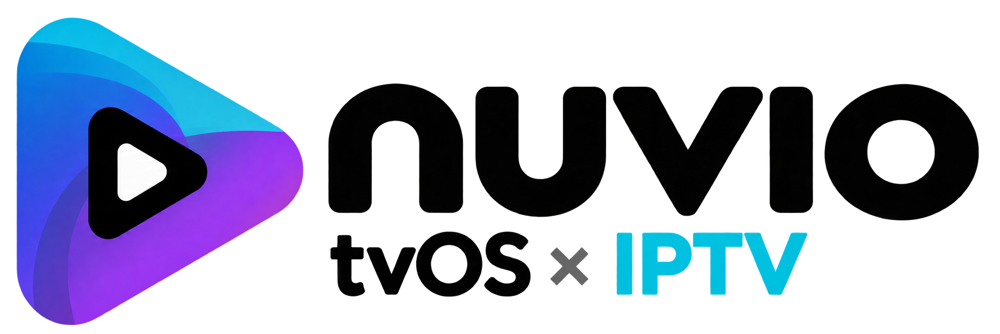

<div align="center">

  <picture>
    <source media="(prefers-color-scheme: dark)" srcset="assets/brand/nuvio-iptv-tvos-logo-dark.png" />
    
  </picture>
  <br />
  <br />

  <h1>NuvioTVOS × IPTV</h1>

  <p>
    Nuvio for Apple TV with Live TV / IPTV built in.
    <br />
    A fork of <a href="https://github.com/bobsupra/NuvioTVOS">NuvioTVOS</a> that ports the Live TV features of
    <a href="https://github.com/homelessbrian/NuvioPlusIPTV">Nuvio + IPTV</a> (Android TV) to tvOS.
  </p>

  <p>
    <a href="https://github.com/Arrgh106/NuvioTVOSxIPTV/releases/latest">
      
    </a>
    <a href="https://github.com/Arrgh106/NuvioTVOSxIPTV/actions/workflows/build-ipa.yml">
      
    </a>
    <a href="./LICENSE">
      
    </a>
  </p>

</div>

## What this is

[NuvioTVOS](https://github.com/bobsupra/NuvioTVOS) is a native SwiftUI media player for Apple TV: catalogs, add-ons, profiles, library, calendar, Watch Party, and the AetherEngine / MPVKit players.

[Nuvio + IPTV](https://github.com/homelessbrian/NuvioPlusIPTV) adds a full Live TV side to Nuvio on Android TV (Xtream / M3U, EPG, TiviMate-style guide, catch-up, recordings, sports hub and more), but it's Android only.

**This fork brings those Live TV features to the Apple TV.** Everything from NuvioTVOS stays as it is. Live TV is added as its own sidebar tab and uses the app's built-in player in live mode.

On top of that, the fork syncs more of your [nuvio.tv](https://nuvio.tv) account than upstream does, offers a one-tap Trakt login and plays films and episodes straight from your Jellyfin server.

**Progress and plans:** see [ROADMAP.md](./ROADMAP.md).

## Install

1. Download the newest `.ipa`:
   - from [Releases](https://github.com/Arrgh106/NuvioTVOSxIPTV/releases), or
   - from the latest successful [IPA build](https://github.com/Arrgh106/NuvioTVOSxIPTV/actions/workflows/build-ipa.yml) (**Artifacts** at the bottom of the run, GitHub login required).
     If your sideloading tool fails with *"An Application Group with Identifier … is not available"*, use the `…-no-appgroup` artifact instead: everything works except the Top Shelf rows.
2. Sideload it to your Apple TV with Sideloadly, AltStore/SideStore, atvloadly, Xcode or Apple Configurator. The IPA is unsigned and gets signed with your own Apple ID when you install it.

> **AltStore / SideStore / Feather source:** `https://raw.githubusercontent.com/Arrgh106/NuvioTVOSxIPTV/main/apps.json`

> **Standalone app:** It shows up as **Nuvio IPTV** with its own bundle ID (`io.github.arrgh106.nuvioiptv`), so it installs **next to** NuvioTVOS and keeps its own settings, logins and add-ons. Its URL scheme is `nuvio-iptv://`.

<!-- BEGIN LATEST_BETA -->
No release has been published yet. Grab the IPA from the latest [IPA build](https://github.com/Arrgh106/NuvioTVOSxIPTV/actions/workflows/build-ipa.yml).
<!-- END LATEST_BETA -->

## Live TV setup (Xtream Codes)

1. Open **Live TV** in the sidebar.
2. Enter the **server** your provider gave you (e.g. `http://example.com:8080`), your **username** and your **password**.
3. Pick a **stream format**:
   - **Auto** (default): HLS if your account allows it, otherwise TS.
   - **TS** / **HLS**: force one format if channels don't start.
4. **Sign in.** The login is checked against the provider before anything is saved.

The password is stored in the Apple TV Keychain. Each Nuvio profile has its own Live TV login. The channel list is cached on the device and refreshes every 12 hours, or when you press **Refresh**.

### Using Live TV

- **Groups** (header button): hide the provider's groups you don't need. Type e.g. `DE` in the filter and press **Only these** to keep just those groups. Hidden groups also leave *All channels* and the search.
- **Favorites:** long press a channel and choose *Add to Favorites*. Favorites and *Recently watched* appear at the top of the group list.
- **Search:** type a channel name in the header field and confirm.
- **In the player:** up/down switches to the channel above/below in the group you started from (e.g. within Favorites). The top line shows the channel number and name, the line below what's on now and next.
- Channel rows show what's on now, from your provider's EPG.
- **Catch-up:** on channels with an archive, OK on a past show (marked ↺) plays it; long press OK on the show on now for *Watch from the beginning*. In full screen, Left opens the guide, Right the channel's schedule and dates. Play/Pause pauses; in a replay, pressing it again asks whether to continue or go back to live.
- **Reminders:** OK on a show to come: *Remind me*. A minute before it starts you can switch to it from anywhere in the app. Settings → Live TV lists them.
- **Home:** your favorite channels with what's on, below Continue Watching (Settings → Live TV / VOD → Integration).
- **Wrong or missing programmes?** Long press a channel in the guide → *Assign EPG* and pick the right guide channel.
- **Channel names:** long press a channel or a group → *Rename*. Settings → Live TV / VOD → Channel List → *Name Cleanup* takes words like "USA", "FHD" or "24/7" off the start or end of every name.
- **Your order:** long press a channel → *Reorder Channels* (or a group → *Reorder Groups*). OK picks one up, move to the new place, OK puts it there; Back saves.
- **Your own groups:** long press a channel → *Add to Group…* (pick one of yours or make a new one). The channel stays in its own group too. Your groups sit above the provider's; long press one to rename, delete or reorder it.
- **Parental controls:** Settings → Live TV / VOD → Parental Controls → *Set a PIN* (4 to 8 digits). Then long press a group → *Lock with PIN*, or let groups named Adult, XXX or 18+ lock themselves. Locked groups ask for the PIN and stay out of All Channels, search, favorites and your groups.
- **VOD:** your provider's movies and series show up as *VOD* in a title's stream list, next to your add-ons (matched by TMDB id, or by name and year). Read once a day; Settings → Live TV / VOD → VOD. The *VOD* page in the sidebar has a row per category (Movies / Series), and Home a *VOD* row with what the provider added last. A title opens Nuvio's own details when it can be matched, otherwise the provider's details. Search also finds the provider's titles your add-ons don't have (at the end of the results). Settings → Live TV / VOD → VOD → *Categories*: hide categories or lock them with the parental PIN; *Merge Duplicates* shows each title once, its stream list offers every version.
- **Jellyfin page:** your Jellyfin libraries in the sidebar, a row each. Settings → Appearance: the VOD and Jellyfin pages (Sidebar) and their Home rows (Home Rows) can each be turned off; their streams stay in the stream lists.
- **More guides:** Settings → Live TV / VOD → Guide Sources → *Add XMLTV Guide* (a link to an `.xml` or `.xml.gz` file). Each guide can be turned off and moved in time; a channel takes the guide with real listings that goes furthest ahead. The provider's own guide can be turned off there too.

## nuvio.tv account sync

Sign in with your Nuvio account and pick a profile. Besides what upstream syncs (library, progress, add-ons, profile settings), the fork also syncs, in both directions:

| What | Notes |
| --- | --- |
| API keys: TMDB, MDBList, TorBox, Premiumize, Real-Debrid | Stored in the Keychain on the Apple TV |
| Jellyfin servers | Address, user and access token; servers you add on the Apple TV go to your account too |
| Trakt options | Progress source, library source, "More like this", Continue Watching days, comments, unaired Next Up |
| Trailer options | Trailers on/off and delay |

The last change wins. Trakt and Simkl logins themselves can't be synced (nuvio.tv doesn't store them): connect once per device.

## Trakt

**Settings → Integrations → Trakt → Connect**, scan the QR code with your phone and approve. No Client ID or secret to enter. Scrobbling is on by default once connected. You can still use your own Trakt API app via *Use your own Trakt app*.

## Jellyfin

You don't need to import your library. When you open a film or an episode (from Cinemeta, TMDB, …), the app asks your Jellyfin server(s) live whether they have it, matched by IMDb/TMDB id, and lists the file as a **Jellyfin** stream next to your add-ons.

Reading a library into the app (for upstream's Jellyfin Home rows) is optional. After the first full read, background syncs only fetch what changed, and the sync screen shows its progress.

## Feature status

What is done and what is planned, compared with Nuvio + IPTV:

| Feature | Status |
| --- | --- |
| Xtream Codes login, account expiry & connections | ✅ Done |
| Channel groups, channel list with numbers & logos (fast with 50k+ channels) | ✅ Done |
| Live playback in the built-in player (live mode) | ✅ Done |
| Channel zapping in the player (up/down within the group) | ✅ Done |
| Now / next from the provider's EPG (channel list and player) | ✅ Done |
| Hide groups, favorites, recently watched, channel search | ✅ Done |
| Full EPG (`xmltv.php`) | ✅ Done |
| Guide matching by name, "Assign EPG" | ✅ Done |
| Programme reminders, Live TV row on Home | ✅ Done |
| Extra XMLTV guides, merging, time shift per guide | ✅ Done |
| TiviMate-style TV guide grid, info panel, overlay mode | ✅ Done |
| Rename channels and groups, name cleanup | ✅ Done |
| Reorder channels and groups | ✅ Done |
| Custom groups | ✅ Done |
| Parental controls (PIN lock for groups) | ✅ Done |
| Catch-up, restart live shows | ✅ Done |
| Time-shift (pause and rewind live without an archive) | 🗓 Planned |
| VOD (provider movies & series, matched to Nuvio details) | 🚧 In progress |
| M3U playlists (link / Dispatcharr) | 🗓 Planned |
| Live TV in search, "Find & stream" through your add-ons | 🗓 Planned |
| Sports hub (scores, schedules, channels showing a game) | 🗓 Planned |
| Calendar extensions | 🗓 Planned |
| Setup sync between devices | 🗓 Planned |
| Recordings | ⚠️ Limited by tvOS, see below |
| Built-in VPN (WireGuard / OpenVPN) | ⚠️ Limited by tvOS, see below |

### tvOS limits

- **Recordings:** tvOS doesn't let apps record in the background or in standby, and the Apple TV has no USB storage. At most, recording would work while the app is open, saving to an SMB network share.
- **VPN:** A VPN tunnel needs Apple's Network Extension entitlement, which a free Apple ID can't sign when sideloading. It may be possible with a paid developer account later. Until then, use a VPN on your router.

## Building

You don't need a Mac. Every push runs [`.github/workflows/build-ipa.yml`](.github/workflows/build-ipa.yml) on a GitHub-hosted macOS runner and uploads an unsigned IPA as an artifact. Pushing a tag like `v0.1.0` also publishes a GitHub Release with the IPA.

The upstream code targets the tvOS 27 SDK (Xcode 27), but GitHub's runners currently ship Xcode 26. The few tvOS 27-only sidebar APIs are wrapped in `#if compiler(>=6.4)`. Built with Xcode 26, the profile button appears as a sidebar tab instead of in the tvOS 27 sidebar header. Everything else is unchanged.

To build locally on a Mac you need Xcode (26 or 27), [mise](https://mise.jdx.dev) and [Tuist](https://tuist.dev) (version pinned in `mise.toml`):

```bash
git clone https://github.com/Arrgh106/NuvioTVOSxIPTV.git
cd NuvioTVOSxIPTV
mise install
(cd tvosApp && tuist generate)
./scripts/build-ipa.sh        # unsigned IPA in ./build-ipa
```

### Where the Live TV code lives

| Path | Contents |
| --- | --- |
| [`tvosApp/NuvioTV/Sources/Core/LiveTV/`](tvosApp/NuvioTV/Sources/Core/LiveTV) | Xtream API client, models, account and Keychain storage, channel cache, `LiveTVStore` (groups, favorites, search), EPG cache, zapping |
| [`tvosApp/NuvioTV/Sources/UI/LiveTV/`](tvosApp/NuvioTV/Sources/UI/LiveTV) | Live TV tab: login form, group and channel lists (`UICollectionView`), group manager |
| [`tvosApp/NuvioTV/Sources/Core/AccountSync/`](tvosApp/NuvioTV/Sources/Core/AccountSync) | Extra nuvio.tv sync: API keys, Jellyfin servers, Trakt/trailer options |
| [`tvosApp/NuvioTV/Sources/Core/JellyfinMatch/`](tvosApp/NuvioTV/Sources/Core/JellyfinMatch) | Jellyfin live lookup, catalog matching, incremental library sync |
| [`tvosApp/NuvioTV/Sources/Core/Updates/AppRepository.swift`](tvosApp/NuvioTV/Sources/Core/Updates/AppRepository.swift) | Fork identity: repo, URL scheme, built-in Trakt/Simkl client IDs |
| [`tvosApp/NuvioTV/Sources/NuvioTVApp.swift`](tvosApp/NuvioTV/Sources/NuvioTVApp.swift) | `TVTab.liveTV` and the hand-off to the built-in player |

Channels are passed to the player with an `iptv:` id and the `channel` type, which switches the player into its live mode (fast zapping start, no resume or scrobbling).

## Credits

- [NuvioTVOS](https://github.com/bobsupra/NuvioTVOS) by bobsupra and contributors: the tvOS app this fork is based on.
- [Nuvio + IPTV](https://github.com/homelessbrian/NuvioPlusIPTV) by homelessbrian: the Live TV design and behaviour being ported.
- [Nuvio](https://github.com/tapframe/NuvioTV) by tapframe: the original app.

For everything the upstream app does (player, HDR / Dolby Vision, audio, subtitles, Usenet, torrents, tracking services), see the [NuvioTVOS README](https://github.com/bobsupra/NuvioTVOS#readme).

## License

GPL-3.0, like both upstream projects. See [LICENSE](./LICENSE).

## Legal

This app only plays content from sources you configure yourself, such as add-ons or your own IPTV subscription. It does not host, store or distribute any media and doesn't come with any channels or playlists. Only use it with content you are allowed to access.

See also the upstream [Legal & Disclaimer page](https://nuvioapp.space/legal).
